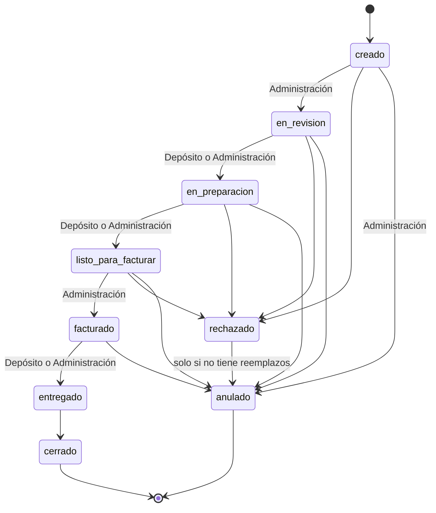
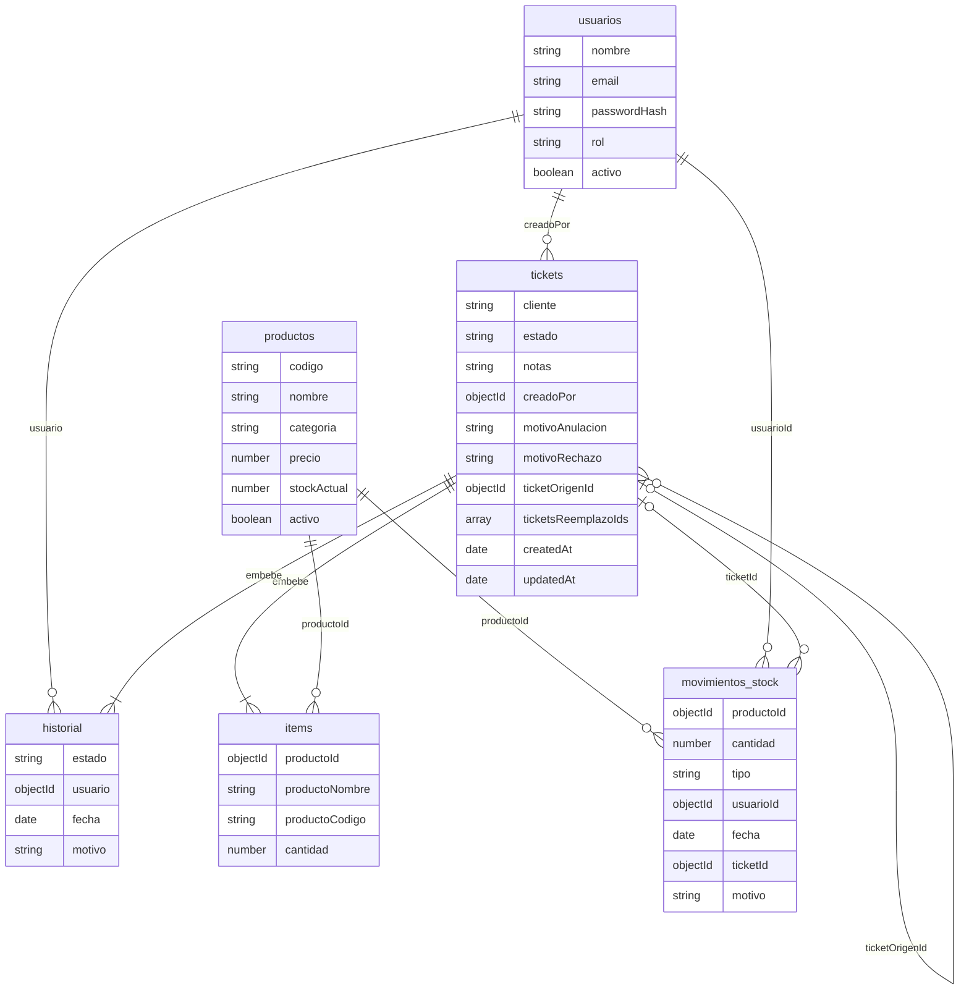
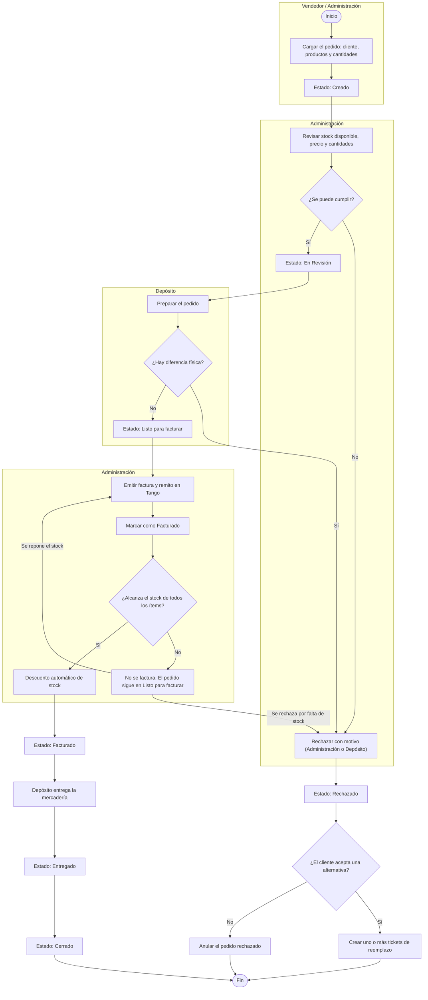
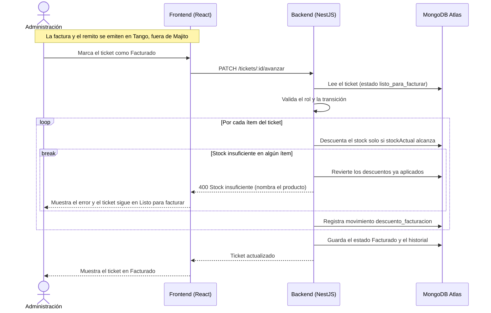
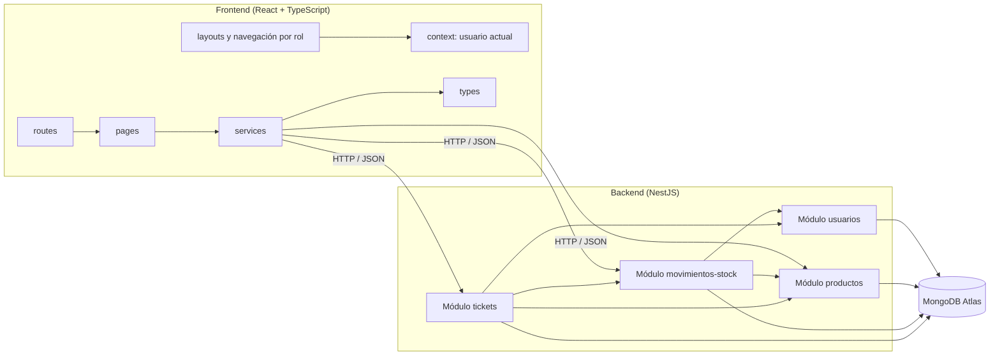
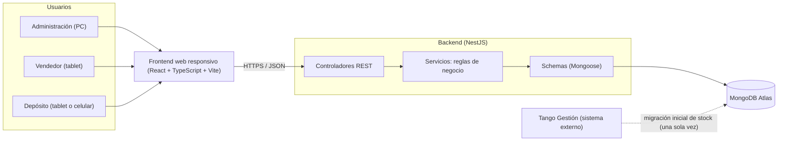
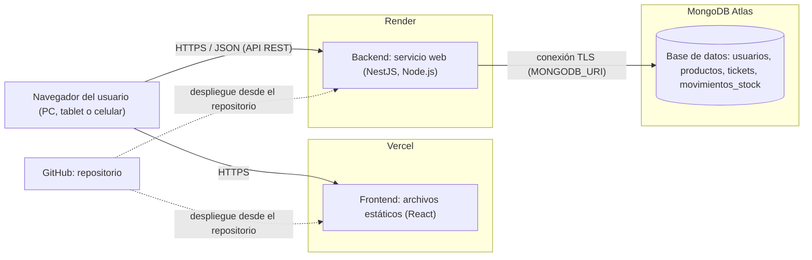

# Majito — Diagramas
 
Diagramas del sistema, escritos en Mermaid (GitHub los renderiza directamente). Los
nombres de estados, colecciones y campos coinciden con el Esquema de base de datos y con las
Reglas de Negocio.
 
1. [Estados del ticket](#1-estados-del-ticket)
2. [Modelo de datos completo (DER)](#2-modelo-de-datos-completo-der)
3. [Actividades: ciclo de vida de un pedido](#3-actividades-ciclo-de-vida-de-un-pedido)
4. [Secuencia: facturación con descuento de stock](#4-secuencia-facturación-con-descuento-de-stock)
5. [Componentes](#5-componentes)
6. [Arquitectura](#6-arquitectura)
7. [Despliegue](#7-despliegue)
## 1. Estados del ticket
 
Cada transición indica el rol que la ejecuta. La anulación es exclusiva de Administración;
el rechazo puede hacerlo Administración o Depósito.
 

 
## 2. Modelo de datos completo (DER)
 
Incluye los subdocumentos `items` e `historial`, que en MongoDB se guardan embebidos dentro
de cada ticket. El Esquema de base de datos contiene la versión resumida.
 

 
## 3. Actividades: ciclo de vida de un pedido
 
Recorrido de un pedido por las áreas, con las excepciones de rechazo y de stock insuficiente.
 

 
## 4. Secuencia: facturación con descuento de stock
 
Al pasar un ticket a Facturado, el sistema descuenta el stock ítem por ítem con una operación
atómica condicionada. Si algún ítem no alcanza, revierte lo ya descontado y no factura.
 

 
## 5. Componentes
 
Módulos del backend y capas del frontend. Los módulos del backend dependen entre sí de la
forma que indican las flechas.
 

 
## 6. Arquitectura
 
Aplicación web en tres capas. Tango Gestión es un sistema externo: emite la factura, el remito
y la nota de crédito, y es el origen de la migración inicial de stock.
 

 
## 7. Despliegue
 
Despliegue previsto en servicios en la nube (RNF-05). Hoy el sistema se ejecuta en forma local.
 

 